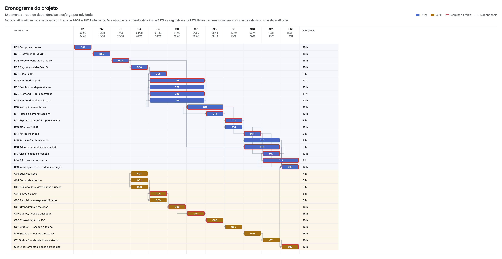
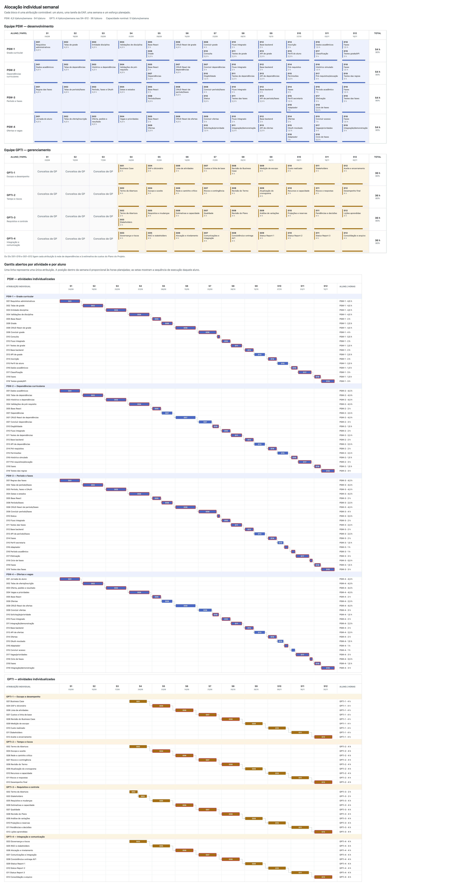
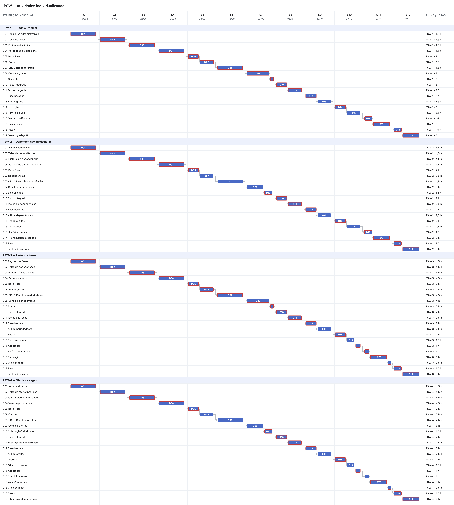
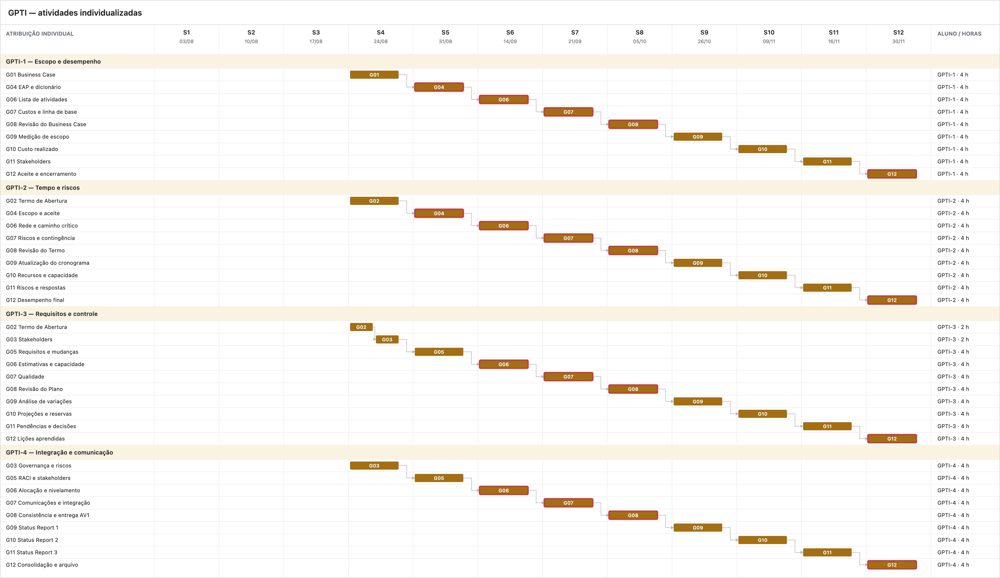

# Plano de Projeto — Módulo de Inscrição em Disciplinas

**Versão:** 1.1 — marcos adiados uma semana letiva; aula prática de 28 e 29/09 fora do calendário  
**Data:** 28/09/2026  
**Patrocinador:** Prof. Diogo Mendonça  
**Equipe:** 4 alunos de PSW (produto e desenvolvimento) e 4 alunos de GPTI (gestão e validação interna do escopo)

> Este documento contém a declaração do escopo, os requisitos, a matriz de rastreabilidade, a EAP, o cronograma, os recursos, os custos, os riscos e o engajamento. O dicionário da EAP, com aceite de cada pacote, está em [dicionario-eap.md](dicionario-eap.md). Os identificadores PSW-1 a PSW-4 e GPTI-1 a GPTI-4 serão substituídos pelos nomes dos alunos quando a equipe for confirmada. GPTI-1 é o gerente do projeto.

**Números da linha de base**

| O quê | Valor | Onde |
|---|---:|---|
| Iniciação, ordem de grandeza | 520 h, R$ 9.800 (−25% a +75%) | Caso de negócio 12.1 |
| Capacidade dos calendários | 240 h PSW + 180 h GPTI = 420 h | 5.3 |
| Atividades niveladas | 216 h PSW + 144 h GPTI = 360 h, R$ 6.784,62 | 5.2, 6.2 |
| Segunda estimativa, pelo entregável | 328 h; PSW +8 h, GPTI −40 h | 6.2.1 |
| Contingência, por evento nomeado | 56 h = 24 h PSW + 32 h GPTI, R$ 1.055,38 | 6.3.3 |
| Linha de base de custos | 416 h, R$ 7.840,00 | 6.4 |
| Reserva gerencial, fora da linha de base | 7%, R$ 548,80 | 6.4 |
| Orçamento total simulado | R$ 8.388,80; desembolso R$ 0 | 6.4, termo 10 |
| Marcos | M1/AV1 na S8: GPTI 05/10 e PSW 06/10. M2 na S12: PSW 10/11; aceite GPTI 30/11 | 5.1 |

## 1. Objetivo da EAP

Decompor o trabalho e as entregas do protótipo em componentes gerenciáveis, cobrindo os casos de uso informados. A EAP é orientada a entregas; a numeração representa a relação hierárquica, não uma sequência de execução.

O produto desta fase é um protótipo acadêmico. Os requisitos e regras de matrícula são hipóteses definidas pelos alunos de PSW e validadas internamente pelos alunos de GPTI; não equivalem a regras aprovadas pela secretaria acadêmica ou pela instituição.

Os itens numerados com quatro níveis, como 1.4.1.1, são atividades usadas no cronograma. O pacote de trabalho é o nível anterior, como 1.4.1. Aceite, fronteira e responsável por prestar contas estão no dicionário, não nesta árvore.

## 2. EAP / WBS

### 1.0 Projeto do módulo de inscrição em disciplinas

- **1.1 Gestão e coordenação do projeto**
  - 1.1.1 Termo de abertura e plano de trabalho mantidos
  - 1.1.2 Backlog, decisões, riscos e mudanças acompanhados
  - 1.1.3 Demonstrações e aceites internos dos marcos registrados
  - 1.1.4 Atividades de aprendizagem, pareamento e revisão técnica organizadas

- **1.2 Requisitos e desenho funcional**
  - 1.2.1 Escopo funcional inicial proposto por PSW e validado por GPTI
  - 1.2.2 Atores, permissões simuladas e fluxos de inscrição definidos para o protótipo
  - 1.2.3 Modelo de dados e contratos de API definidos
  - 1.2.4 Dados acadêmicos necessários identificados: data de início/inscrição no curso e coeficiente de rendimento (CR)
  - 1.2.5 Hipóteses, regras pendentes e limitações documentadas
  - 1.2.6 Protótipos de tela e navegação revisados internamente

- **1.3 Base técnica e ambientes**
  - 1.3.1 Aplicação React/JavaScript inicializada
  - 1.3.2 API JavaScript/Express inicializada
  - 1.3.3 Persistência MongoDB configurada para desenvolvimento
  - 1.3.4 `json-server` configurado para os endpoints acadêmicos simulados durante o projeto e para o frontend no primeiro marco
  - 1.3.5 Fluxo de autenticação OAuth simulado, sem credenciais ou dados reais
  - 1.3.6 Endpoints simulados do sistema acadêmico configurados no `json-server` para data de ingresso, CR e histórico de disciplinas concluídas; período curricular esperado derivado do calendário e da grade
  - 1.3.7 Perfil e permissões de secretaria simulados para funções administrativas do protótipo

- **1.4 Marco 1 — Frontend dos fluxos priorizados, com backend mockado**
  - 1.4.1 Interface de gestão de grade curricular construída
    - 1.4.1.1 Criar, consultar, editar e remover disciplinas da grade
    - 1.4.1.2 Associar período curricular a cada disciplina
    - 1.4.1.3 Cadastrar e consultar dependências entre disciplinas
  - 1.4.2 Interface de configuração de período de inscrição construída
    - 1.4.2.1 Configurar período letivo/calendário e oferta de disciplinas
    - 1.4.2.2 Configurar datas de abertura e encerramento das três fases sequenciais de matrícula
    - 1.4.2.3 Revisar a regra fixa de classificação e os dados de entrada do período
    - 1.4.2.4 Revisar e confirmar configurações antes de abrir o período de inscrição
  - 1.4.3 Interface de consulta de disciplinas disponíveis construída
    - 1.4.3.1 Listar disciplinas disponíveis
    - 1.4.3.2 Filtrar disciplinas por período curricular
  - 1.4.4 Interface para composição e acompanhamento da inscrição construída
    - 1.4.4.1 Adicionar disciplina à inscrição
    - 1.4.4.2 Definir e alterar ordem de prioridade das disciplinas
    - 1.4.4.3 Remover disciplina da inscrição
    - 1.4.4.4 Consultar andamento/status da inscrição
    - 1.4.4.5 Submeter inscrição
  - 1.4.5 Interface de resultado e fases subsequentes de matrícula construída
    - 1.4.5.1 Consultar resultado de alocação
    - 1.4.5.2 Consultar situação de inscrição efetivada ou não efetivada em cada fase
    - 1.4.5.3 Alterar, nas fases seguintes, a solicitação para disciplinas sem inscrição efetivada
    - 1.4.5.4 Submeter alterações para novo cálculo na fase seguinte
  - 1.4.6 Fluxos de frontend conectados aos endpoints simulados do `json-server`
  - 1.4.7 Demonstração do marco 1 e limitações do mock documentadas

- **1.5 Backend e regras de negócio**
  - 1.5.1 API de grade curricular implementada
    - 1.5.1.1 Operações CRUD de disciplinas
    - 1.5.1.2 Associação de disciplinas a períodos curriculares
    - 1.5.1.3 Registro e consulta de dependências entre disciplinas
  - 1.5.2 API de período e fases de matrícula implementada
    - 1.5.2.1 Cadastro e consulta do período letivo/calendário de inscrição
    - 1.5.2.2 Cadastro e consulta das três fases sequenciais de matrícula
    - 1.5.2.3 Validação e congelamento da configuração ao abrir a primeira fase
  - 1.5.3 Configuração administrativa da oferta implementada
    - 1.5.3.1 Configurar disciplinas ofertadas, período curricular e número de vagas
    - 1.5.3.2 Configurar/consultar dependências curriculares
    - 1.5.3.3 Configurar calendário acadêmico e correspondência entre semestres e períodos curriculares
    - 1.5.3.4 Validar a configuração antes da abertura da fase 1 e bloquear alterações incompatíveis após a abertura
  - 1.5.4 API de oferta e consulta de disciplinas implementada
    - 1.5.4.1 Consulta de disciplinas abertas/disponíveis
    - 1.5.4.2 Filtro por período curricular
  - 1.5.5 API de inscrição do aluno implementada
    - 1.5.5.1 Adicionar disciplina e prioridade à inscrição
    - 1.5.5.2 Alterar ordem de prioridade
    - 1.5.5.3 Remover disciplina
    - 1.5.5.4 Consultar estado/andamento
    - 1.5.5.5 Submeter inscrição
  - 1.5.6 Serviço de cálculo e efetivação de inscrições implementado
    - 1.5.6.1 Obter ou simular data de início no curso, CR e histórico de disciplinas concluídas; derivar o período curricular correto a partir da data de ingresso, calendário e grade curricular
    - 1.5.6.2 Validar elegibilidade e dependências curriculares usando o histórico de disciplinas concluídas
    - 1.5.6.3 Classificar em ordem fixa: período correto primeiro, data de ingresso mais antiga em seguida, CR maior depois e identificador do aluno crescente como desempate final
    - 1.5.6.4 Alocar vagas por disciplina, tentando respeitar a classificação dos alunos e a ordem de prioridade de disciplinas informada por cada aluno
    - 1.5.6.5 Efetivar inscrição somente quando a alocação garantir vaga; pedido submetido, por si só, não significa inscrição efetivada
    - 1.5.6.6 Registrar disciplinas efetivadas e não efetivadas e produzir resultado por aluno e disciplina
  - 1.5.7 Serviços de ciclo de matrícula implementados
    - 1.5.7.1 Processar e publicar resultado da fase 1
    - 1.5.7.2 Permitir alteração, na fase 2, das disciplinas sem inscrição efetivada e recalcular vagas
    - 1.5.7.3 Permitir alteração, na fase 3, das disciplinas sem inscrição efetivada e recalcular vagas
    - 1.5.7.4 Preservar inscrição efetivada em fase anterior nas fases seguintes
  - 1.5.8 Consumo dos endpoints acadêmicos simulados implementado para data de ingresso, CR e histórico de disciplinas concluídas
  - 1.5.9 Fluxo OAuth demonstrado somente por mock, sem conexão ao provedor institucional
  - 1.5.10 Perfil e permissões administrativas de secretaria simulados
  - 1.5.11 Dados de domínio persistidos no MongoDB

- **1.6 Marco 2 — Sistema integrado ao backend próprio (Express/MongoDB)**
  - 1.6.1 Frontend conectado às APIs Express
  - 1.6.2 Fluxos completos persistidos e recuperados do MongoDB
  - 1.6.3 Regra fixa de classificação por período correto, antiguidade, CR e identificador executada e demonstrada
  - 1.6.4 Fluxos de cálculo, efetivação e três fases de matrícula integrados
  - 1.6.5 Backend Express integrado aos endpoints acadêmicos simulados pelo `json-server`, incluindo histórico de disciplinas concluídas
  - 1.6.6 Fluxo de autenticação OAuth demonstrado por mock; sem integração efetiva com o provedor institucional
  - 1.6.7 Perfil de secretaria simulado nos fluxos administrativos
  - 1.6.8 Erros e estados inválidos tratados nos fluxos prioritários
  - 1.6.9 Demonstração integrada final preparada

- **1.7 Verificação e encerramento acadêmico**
  - 1.7.1 Testes dos fluxos e regras de negócio prioritários executados
  - 1.7.2 Testes da ordem de classificação de alunos documentados
  - 1.7.3 Defeitos prioritários corrigidos ou registrados como limitações conhecidas
  - 1.7.4 Instruções de instalação, configuração e execução documentadas
  - 1.7.5 Apresentação final, aceite interno e lições aprendidas registrados
  - 1.7.6 Pendências para validação institucional futura registradas

## 3. Regras de negócio do protótipo

As regras abaixo incorporam as sugestões aceitas pelo patrocinador/equipe. São regras do protótipo acadêmico e não devem ser apresentadas como política oficial da instituição até validação institucional futura.

1. **Dados acadêmicos do aluno:** no sistema real, data de ingresso, CR e histórico de disciplinas concluídas serão consultados no sistema acadêmico existente. A equipe poderá reutilizar esses dados em outras funcionalidades do protótipo se necessário e se estiverem dentro do escopo aprovado. Nesta etapa, sem autorização ou acesso institucional, serão usados dados fictícios por meio de um adaptador/mock com a mesma estrutura prevista para a integração.
2. **Período curricular esperado:** calcular a partir da data de ingresso do aluno, calendário letivo configurado e grade curricular. Para simplificar o primeiro protótipo, assumir progressão regular e não ajustar por trancamentos, reprovações ou aceleração.
3. **Elegibilidade por dependências:** validar o histórico de disciplinas concluídas antes da classificação e da alocação. Se uma dependência obrigatória não estiver concluída, a inscrição naquela disciplina não pode ser efetivada.
4. **Classificação fixa e lexicográfica:** ordenar candidatos, nesta sequência: (a) aluno no período curricular correto para a disciplina primeiro; (b) data de ingresso mais antiga primeiro; (c) CR maior primeiro; (d) identificador do aluno em ordem crescente como desempate final determinístico. Não usar soma livre de pontos que permita a um critério inferior ultrapassar um superior. Uma pontuação exibida, se necessária, será derivada dessa ordem e não mudará a classificação.
5. **Alocação:** processar alunos na ordem de classificação; para cada aluno, percorrer as disciplinas solicitadas conforme a ordem de prioridade indicada. Efetivar inscrição somente se dependências forem atendidas e houver vaga; caso contrário, registrar como não efetivada. A prioridade do aluno é principal; a ordem das disciplinas guia a tentativa para cada aluno.
6. **Fases:** realizar três fases sequenciais. Após cada resultado, permitir que o aluno altere somente as solicitações sem inscrição efetivada e as submeta para a fase seguinte. Inscrições efetivadas em uma fase permanecem garantidas nas fases seguintes; o reprocessamento considera as vagas ainda disponíveis e não retira vagas confirmadas.
7. **Pedido e efetivação:** submeter uma solicitação não equivale a estar inscrito. A inscrição torna-se efetiva apenas após a alocação de uma vaga pelo processamento da fase.

### 3.1 Configurações feitas pela secretaria simulada

Antes de criar/abrir o período de inscrição, o perfil de secretaria poderá configurar e revisar os parâmetros operacionais:

- Período letivo, calendário e correspondência entre semestres letivos e períodos curriculares.
- Disciplinas ofertadas, período curricular de cada disciplina, vagas e dependências curriculares.
- Datas e horários de abertura e encerramento das três fases.
- Dados de exemplo para simular os registros acadêmicos necessários no protótipo.

A ordem dos critérios de classificação descrita acima é fixa no protótipo, não um parâmetro livre que a secretaria possa inverter. A configuração deve ser validada antes de abrir a primeira fase e, depois da abertura, ficar congelada para manter resultados reproduzíveis. O perfil e as configurações são apenas simulações: a secretaria real não participa nem aprova as regras nesta etapa.

### 3.2 Integrações fora do escopo deste projeto

- Não haverá conexão efetiva ao sistema acadêmico nem ao provedor OAuth institucional neste projeto. Os endpoints acadêmicos serão simulados com `json-server` e o OAuth será mockado.
- A integração real, a obtenção de credenciais/acessos e a validação dos contratos com os sistemas institucionais exigem projeto ou etapa futura, com autorização da instituição.
- Os dados acadêmicos simulados poderão apoiar outros fluxos do protótipo se necessário, desde que a equipe aprove a inclusão no escopo. O uso de dados reais ou a ampliação para produção exige autorização e avaliação institucional.

## 4. Linha de base do escopo

A linha de base do escopo é a versão aprovada destes três artefatos: a declaração abaixo, a EAP da seção 2 e o [dicionário](dicionario-eap.md). Ela só muda por controle de mudanças. Cronograma e custo das seções seguintes descrevem este mesmo recorte, não o cenário futuro de implantação usado nos indicadores do caso de negócio.

### 4.1 Declaração do escopo

Entregar, em 12 semanas, um protótipo em que um aluno fictício consulta disciplinas, monta um pedido com prioridade, submete e vê o resultado de cada fase, distinguindo pedido de inscrição efetivada. A equipe GPTI entrega os artefatos de gestão no calendário da disciplina. Secretaria, OAuth institucional e sistema acadêmico real permanecem fora.

Premissas que ainda valem: progressão curricular regular; dados fictícios no formato previsto para uma integração futura; quatro alunos de PSW programam e quatro de GPTI gerenciam; dedicação máxima de 5 h/semana.

Critério geral de aceite: na semana 12, a equipe GPTI aceita a demonstração, com ciência do patrocinador, se os casos do dicionário dos pacotes 1.4, 1.5 e 1.6 forem reproduzidos sem violar a ordem de classificação, o pré-requisito ou a vaga já efetivada.

### 4.2 Necessidade e solução

O requisito registra a necessidade. A solução é uma escolha de desenho e pode mudar sem mudar a necessidade.

| ID | Necessidade | Origem | Solução adotada neste protótipo |
|---|---|---|---|
| REQ-01 | Solicitar disciplinas sem formulário em papel e sem deslocamento. | Experiência dos alunos com o processo atual. | Telas de consulta, pedido, prioridade e submissão. |
| REQ-02 | Saber se o pedido virou vaga ou continua apenas solicitado. | Regra aprovada para o protótipo. | Estados de pedido e de inscrição efetivada, visíveis ao aluno. |
| REQ-03 | Não efetivar disciplina cujo pré-requisito não foi concluído. | Regra aprovada para o protótipo. | Validação antes da alocação, com histórico fictício. |
| REQ-04 | Ordenar candidatos por período correto, ingresso, CR e identificador. | Regra aprovada para o protótipo. | Classificação lexicográfica fixa, sem pesos livres. |
| REQ-05 | Permitir até três fases, sem retirar vaga já efetivada. | Regra aprovada para o protótipo. | Reprocessamento só das solicitações não efetivadas. |
| REQ-06 | Configurar período, oferta, vagas e dependências antes da abertura. | Perfil simulado de secretaria. | Telas e APIs administrativas, congeladas na fase 1. |
| REQ-07 | Consultar a oferta filtrando pelo período curricular. | Caso de uso informado. | Lista e filtro no frontend e na API. |
| REQ-08 | Demonstrar login sem acessar o provedor institucional. | Restrição do termo de abertura. | Mock OAuth, sem credencial real. |
| REQ-09 | Usar data de ingresso, CR e histórico no formato de uma consulta futura. | Caso de negócio e termo. | Endpoints fictícios no `json-server`. |
| REQ-10 | Conduzir o projeto e registrar aceite, risco e encerramento. | Plano de ensino de GPTI. | Artefatos G01–G12, sem programação pela equipe GPTI. |

### 4.3 Matriz de rastreabilidade

| ID | Pacotes | Aceite observável |
|---|---|---|
| REQ-01 | 1.4.3, 1.4.4, 1.5.4, 1.5.5 | Um aluno fictício consulta, inclui, prioriza, remove e submete sem planilha. |
| REQ-02 | 1.4.5, 1.5.6, 1.6.4 | A tela mostra pedido submetido e, separadamente, inscrição efetivada. |
| REQ-03 | 1.5.6, 1.6.3 | Disciplina com pré-requisito ausente não recebe vaga. |
| REQ-04 | 1.5.6, 1.6.3 | Os casos do dicionário saem na ordem período, ingresso, CR e identificador. |
| REQ-05 | 1.4.5, 1.5.7, 1.6.4 | A vaga efetivada na fase 1 permanece após as fases 2 e 3. |
| REQ-06 | 1.4.2, 1.5.2, 1.5.3 | Configuração inválida não abre a fase 1; depois de aberta, não muda. |
| REQ-07 | 1.4.3, 1.5.4 | O filtro por período devolve só as disciplinas daquele período. |
| REQ-08 | 1.3.5, 1.5.9, 1.6.6 | O fluxo de login termina sem chamada ao provedor institucional. |
| REQ-09 | 1.3.6, 1.5.8, 1.6.5 | Ingresso, CR e histórico vêm do mock e alimentam o cálculo. |
| REQ-10 | 1.1, 1.7 | AV1 na semana 8 e termo de encerramento na semana 12. |

## 5. Processo de elaboração do cronograma

O cronograma foi desenvolvido a partir da EAP seguindo os processos de gerenciamento do cronograma do PMI e integrado ao planejamento de recursos e custos. O resultado não é apenas a distribuição das 12 semanas: cada atividade possui predecessor, esforço, responsável, janela de execução e custo.

### 5.1 Planejar o gerenciamento do cronograma

- **Unidade de planejamento:** semana letiva; o acompanhamento do realizado será em horas-pessoa.
- **Horizonte:** 12 semanas letivas. M1 e AV1 na semana 8. M2 na semana 12.
- **Calendários:** cada aluno dispõe de até 5 h/semana. PSW trabalha no projeto nas semanas 1–12. GPTI estuda conceitos nas semanas 1–3 sem produzir artefatos do projeto e trabalha no projeto nas semanas 4–12. A semana letiva só avança na aula da disciplina. GPTI é segunda; PSW é terça. Dia sem aula não conta: 11/08, 07/09, 12/10, 19/10, 20/10, 02/11, 23/11 e 24/11. A aula de 28/09 (GPTI) e 29/09 (PSW) foi prática extra, fora do calendário previsto: não conta como semana do projeto e não acrescenta hora. Por isso os dois marcos andam uma semana letiva. A semana 1 começou em 03/08.
- **Ferramentas:** EAP, lista de atividades, diagrama de precedências, quadro de tarefas e apontamento semanal.
- **Método de estimativa:** o calendário de recursos é fixado antes e nivela as atividades. A seção 6.2.1 estima os pacotes de novo, pelo entregável, e compara com esse calendário. Diferença zero não seria conferência: seria a mesma hora contada duas vezes. A base é o escopo conhecido, a aprendizagem simultânea e a revisão humana obrigatória do trabalho apoiado por IA. O esforço não é reduzido automaticamente pelo uso de IA.
- **Regras de atualização:** progresso medido por esforço realizado, esforço restante e entrega aceita, não por percentual subjetivo. A linha de base somente muda por controle de mudanças.
- **Limites de controle:** variação prevista superior a 10% do esforço da atividade, atraso que consuma a folga de um marco ou previsão acima de 416 h exige análise e ação corretiva; mudança de escopo, prazo ou orçamento total exige decisão do patrocinador.

| Semana | GPTI | PSW |
|---:|---|---|
| 1 | 03/08 | 04/08 |
| 2 | 10/08 | 18/08 |
| 3 | 17/08 | 25/08 |
| 4 | 24/08 | 01/09 |
| 5 | 31/08 | 08/09 |
| 6 | 14/09 | 15/09 |
| 7 | 21/09 | 22/09 |
| 8 — M1 e AV1 | 05/10 | 06/10 |
| 9 | 26/10 | 13/10 |
| 10 | 09/11 | 27/10 |
| 11 | 16/11 | 03/11 |
| 12 — M2 | 30/11 | 10/11 |

A AV1 das duas disciplinas é na semana 8: GPTI em 05/10 e PSW em 06/10. Até a semana 8 as aulas ainda caem na mesma semana de calendário. Da semana 9 em diante, não. O desenvolvimento da semana 12 de PSW é 10/11. O aceite do M2 é na aula de GPTI de 30/11, porque 23/11 não tem aula. O intervalo não acrescenta esforço. O status da semana 10 de GPTI, em 09/11, olha a semana 10 de PSW, já ocorrida em 27/10.

### 5.2 Definir e sequenciar as atividades

As atividades foram derivadas dos pacotes da EAP e ordenadas pelo método de diagrama de precedência. **FS** significa término–início; **SS** permite início em paralelo depois que a predecessora começou. Como o controle é semanal, atividades SS da mesma semana serão ordenadas em tarefas menores no quadro da equipe.

#### Atividades de produto — equipe PSW

| ID | Atividade/saída verificável | Predecessora | Janela | Duração | Esforço | Responsável principal | Custo simulado |
|---|---|---|---:|---:|---:|---|---:|
| D01 | Detalhar escopo, atores, casos de uso e critérios de aceite | — | S1 | 1 sem. | 18 h | PSW-1…4 | R$ 339,23 |
| D02 | Produzir navegação, HTML/CSS e protótipos das telas | D01 (FS) | S2 | 1 sem. | 18 h | PSW-1…4 | R$ 339,23 |
| D03 | Definir modelo de domínio, contratos e dados dos mocks | D01, D02 (FS) | S3 | 1 sem. | 18 h | PSW-1…4 | R$ 339,23 |
| D04 | Prototipar regras, validações e operações em JavaScript | D03 (FS) | S4 | 1 sem. | 18 h | PSW-1…4 | R$ 339,23 |
| D05 | Preparar aplicação React, rotas e componentes compartilhados | D02, D04 (FS) | S5 | 1 sem. | 8 h | PSW-1…4 | R$ 150,77 |
| D06 | Frontend do CRUD de grade curricular | D05 (SS) | S5–S7 | 3 sem. | 11 h | PSW-1 | R$ 207,31 |
| D07 | Frontend do CRUD de dependências | D05 (SS) | S5–S7 | 3 sem. | 10 h | PSW-2 | R$ 188,46 |
| D08 | Frontend do CRUD de período e fases | D05 (SS) | S5–S7 | 3 sem. | 11 h | PSW-3 | R$ 207,31 |
| D09 | Frontend do CRUD de ofertas e vagas | D05 (SS) | S5–S7 | 3 sem. | 10 h | PSW-4 | R$ 188,46 |
| D10 | Integrar solicitação, prioridades, status e resultados no frontend | D06–D09 (SS) | S7–S8 | 2 sem. | 12 h | PSW-1…4 | R$ 226,15 |
| D11 | Testar frontend, corrigir defeitos e demonstrar M1 | D06–D10 (FS/SS) | S8 | 1 sem. | 10 h | PSW-1…4 | R$ 188,46 |
| **M1** | **Frontend aceito com `json-server` e OAuth mockado** | D11 (FS) | **fim S8** | marco | 0 h | Equipes e patrocinador | R$ 0,00 |
| D12 | Preparar Express, MongoDB, arquitetura e persistência | M1 (FS) | S9 | 1 sem. | 8 h | PSW-1…4 | R$ 150,77 |
| D13 | Implementar APIs dos quatro CRUDs de domínio | D12 (SS) | S9 | 1 sem. | 10 h | PSW-1…4 | R$ 188,46 |
| D14 | Implementar API de solicitação, prioridades e submissão | D10, D12 (FS) | S10 | 1 sem. | 8 h | PSW-1…4 | R$ 150,77 |
| D15 | Implementar perfis e controle de acesso com OAuth mockado | D12 (FS) | S10–S11 | 2 sem. | 9 h | PSW-1…4 | R$ 169,62 |
| D16 | Implementar adaptador dos endpoints acadêmicos simulados | D03, D12 (FS) | S10–S11 | 2 sem. | 6 h | PSW-1…3 | R$ 113,08 |
| D17 | Implementar elegibilidade, classificação e alocação | D13, D14, D16 (FS) | S11 | 1 sem. | 12 h | PSW-1…4 | R$ 226,15 |
| D18 | Implementar três fases, preservação de vagas e resultados | D17 (SS) | S11–S12 | 2 sem. | 7 h | PSW-3…4 | R$ 131,92 |
| D19 | Integrar, testar, documentar e demonstrar o sistema | D13–D18 (FS/SS) | S12 | 1 sem. | 12 h | PSW-1…4 | R$ 226,15 |
| **M2** | **Sistema integrado ao backend próprio e encerrado** | D19 (FS) | **fim S12** | marco | 0 h | Equipes e patrocinador | R$ 0,00 |
| **Subtotal PSW** |  |  | **S1–S12** |  | **216 h** |  | **R$ 4.070,77** |

#### Atividades de gerenciamento — equipe GPTI

| ID | Atividade/saída verificável | Predecessora | Janela | Duração | Esforço | Responsável principal | Custo simulado |
|---|---|---|---:|---:|---:|---|---:|
| G01 | Consolidar Business Case | — | S4 | 1 sem. | 4 h | GPTI-1 | R$ 75,38 |
| G02 | Consolidar Termo de Abertura | G01 (SS) | S4 | 1 sem. | 6 h | GPTI-2 e 3 | R$ 113,08 |
| G03 | Identificar stakeholders, governança e riscos iniciais | G02 (SS) | S4 | 1 sem. | 6 h | GPTI-3 e 4 | R$ 113,08 |
| G04 | Detalhar escopo e EAP | G02 (FS) | S5 | 1 sem. | 8 h | GPTI-1 e 2 | R$ 150,77 |
| G05 | Planejar requisitos, mudanças, responsabilidades e stakeholders | G03, G04 (SS) | S5 | 1 sem. | 8 h | GPTI-3 e 4 | R$ 150,77 |
| G06 | Definir atividades, precedências, estimativas, recursos e cronograma | G04 (FS) | S6 | 1 sem. | 16 h | GPTI-1…4 | R$ 301,54 |
| G07 | Elaborar orçamento, riscos, qualidade e comunicações | G05, G06 (FS) | S7 | 1 sem. | 16 h | GPTI-1…4 | R$ 301,54 |
| G08 | Integrar, revisar e entregar os artefatos da AV1 | G01–G07 (FS) | S8 | 1 sem. | 16 h | GPTI-1…4 | R$ 301,54 |
| G09 | Monitorar e controlar escopo e tempo; Status Report 1 | G08, M1 (FS) | S9 | 1 sem. | 16 h | GPTI-1…4 | R$ 301,54 |
| G10 | Monitorar e controlar custos e recursos; Status Report 2 | G09 (FS) | S10 | 1 sem. | 16 h | GPTI-1…4 | R$ 301,54 |
| G11 | Monitorar stakeholders e riscos; Status Report 3 | G10 (FS) | S11 | 1 sem. | 16 h | GPTI-1…4 | R$ 301,54 |
| G12 | Elaborar termo de encerramento e lições aprendidas | G11 (FS), D19 (SS) | S12 | 1 sem. | 16 h | GPTI-1…4 | R$ 301,54 |
| **Subtotal GPTI** |  |  | **S4–S12** |  | **144 h** |  | **R$ 2.713,85** |

### 5.3 Estimar recursos e durações

A duração resulta da relação entre esforço, disponibilidade e precedências, limitada pelo conteúdo já ministrado. Por exemplo, 18 h de trabalho PSW em uma semana exigem 4 alunos × 4,5 h; não significam 18 horas corridas. O nivelamento preserva 0,5 h/semana por aluno PSW e 1 h/semana por aluno GPTI durante suas semanas de projeto.

| Grupo | Pessoas | Calendário disponível | Capacidade máxima | Planejado em atividades | Utilização | Capacidade livre |
|---|---:|---|---:|---:|---:|---:|
| PSW | 4 | 5 h/semana, S1–S12 | 240 h | 216 h | 90% | 24 h |
| GPTI | 4 | 5 h/semana, S4–S12 | 180 h | 144 h | 80% | 36 h |
| **Total** | **8** |  | **420 h** | **360 h** | **85,7%** | **60 h** |

As 60 h livres foram confrontadas com a nova exposição aos riscos na seção 6.3. A reserva reavaliada requer 56 h e será absorvida por 24 h PSW e 32 h GPTI, deixando 4 h livres em GPTI e nenhuma folga PSW. Das 32 h de respostas técnicas, 8 h deverão ser apoio GPTI em dados de teste, critérios de aceite, execução/registro de testes e documentação; não substituem programação. Se a resposta exigir mais de 24 h adicionais de desenvolvimento, será necessário reduzir escopo ou replanejar o marco. A contingência somente entra no cronograma quando um risco registrado ocorrer.

### 5.4 Desenvolver o cronograma e analisar o caminho crítico

Após o sequenciamento, as restrições didáticas e o nivelamento dos oito recursos, a linha de base tem:

- **Início:** semana 1, em 03/08; **término:** aceite do M2 em 30/11.
- **M1/AV1:** semana 8, GPTI em 05/10 e PSW em 06/10. **M2:** semana 12, PSW em 10/11 e aceite de GPTI em 30/11.
- **Caminho crítico técnico, em nível semanal:** D01 → D02 → D03 → D04 → D05 → D06–D10 → D11 → M1 → D12 → D14/D16 → D17 → D18 → D19 → M2.
- **Cadeia crítica de gestão até a AV1:** G01/G02/G03 → G04/G05 → G06 → G07 → G08.
- As atividades do caminho crítico têm folga semanal nula devido aos marcos e à liberação das tecnologias pelo curso. A capacidade não comprometida é proteção contra risco, não folga autorizada para aumentar o escopo.
- A lógica de alocação e as três fases concentram risco na semana 11. Portanto, contratos, dados de teste e casos de classificação devem estar prontos nas semanas 3–4, e a interface deve ser testada com esses cenários no M1.

A versão interativa em [`cronograma-gantt-recursos.html`](cronograma-gantt-recursos.html) permite destacar as predecessoras e sucessoras ao passar o mouse sobre uma atividade. As setas representam as dependências FS/SS da seção 5.2; a coluna à direita apresenta o esforço total da atividade. Esta é a visão da rede, não a alocação nominal usada para controle.

A visão de controle em [`cronograma-alocacao-individual.html`](cronograma-alocacao-individual.html) não utiliza responsáveis agrupados. Cada bloco identifica exatamente um aluno, uma tarefa da EAP, uma semana e suas horas planejadas. Quando um aluno executa mais de uma tarefa na mesma semana, as horas são separadas por tarefa dentro da célula.

#### Gantts individualizados por aluno e atividade

Nestes Gantts, cada linha é uma única atribuição a uma única pessoa. A largura da barra dentro da semana é proporcional ao esforço planejado em relação à capacidade de 5 h/semana. As setas ligam a sequência de execução do próprio aluno; as dependências técnicas entre atividades e entre alunos permanecem na visão de rede anterior.

### 5.4.1 Folga e técnicas de estimativa

A linha de base usa estimativa bottom-up de um ponto, compatível com a aprendizagem da equipe. Duas atividades foram conferidas por três pontos, $E=(O+4M+P)/6$, para verificar se o ponto único estava dentro da esperança:

| Atividade | Otimista | Mais provável | Pessimista | Esperança | Valor na linha de base | Premissa |
|---|---:|---:|---:|---:|---:|---|
| D11 — testes do M1 | 6 h | 10 h | 16 h | 10,3 h | 10 h | Casos principais já escritos nas semanas 3 e 4; a semana 8 só executa e corrige. |
| D17 — classificação e alocação | 8 h | 12 h | 20 h | 12,7 h | 12 h | A ordem é fixa. O pessimista cobre empates e falta de vaga, não uma regra nova. |

A diferença fica abaixo de 1 h em cada atividade, então a linha de base não foi alterada. D06, o CRUD de grade, foi comparado por analogia a um CRUD acadêmico de uma tela com validação, na faixa de 10 a 12 h para quem está aprendendo React. As 11 h adotadas cabem nessa faixa.

Folga de uma atividade fora do caminho crítico: D13 termina na semana 9 e D17, sua sucessora em término–início, só começa na semana 11. O término mais tarde de D13 é a semana 10. A folga é de **1 semana**. Um atraso de D13 dentro dessa semana não empurra M2. D07 e D09 também ficam fora do caminho crítico semanal. Folga de atividade não autoriza escopo novo nem consumo da reserva.

### 5.5 Alocação semanal individual — PSW

Cada célula apresenta atividade, tarefa individual e esforço. Cada aluno recebe **4,5 h/semana**, totalizando **54 h por aluno** e 216 h para PSW. Além do CRUD individual, as funcionalidades integradoras têm revisão cruzada.

| Semana | PSW-1 — grade | PSW-2 — dependências | PSW-3 — período/fases | PSW-4 — ofertas/vagas |
|---:|---|---|---|---|
| 1 | D01: requisitos administrativos — 4,5 h | D01: dados acadêmicos — 4,5 h | D01: regras das fases — 4,5 h | D01: jornada do aluno — 4,5 h |
| 2 | D02: telas de grade — 4,5 h | D02: telas de dependências — 4,5 h | D02: telas de período/fases — 4,5 h | D02: telas de oferta/inscrição — 4,5 h |
| 3 | D03: entidade disciplina — 4,5 h | D03: dependências e histórico mock — 4,5 h | D03: período/fase e OAuth mock — 4,5 h | D03: oferta, solicitação e resultado — 4,5 h |
| 4 | D04: validações de disciplina — 4,5 h | D04: validações de pré-requisito — 4,5 h | D04: datas e estados das fases — 4,5 h | D04: vagas e prioridades — 4,5 h |
| 5 | D05 2 h + D06 grade 2,5 h | D05 2 h + D07 dependências 2,5 h | D05 2 h + D08 período/fases 2,5 h | D05 2 h + D09 ofertas 2,5 h |
| 6 | D06: CRUD React de grade — 4,5 h | D07: CRUD React de dependências — 4,5 h | D08: CRUD React de período/fases — 4,5 h | D09: CRUD React de ofertas — 4,5 h |
| 7 | D06 4 h + D10 consulta 0,5 h | D07 3 h + D10 elegibilidade 1,5 h | D08 4 h + D10 status 0,5 h | D09 3 h + D10 solicitação/prioridade 1,5 h |
| 8 | D10 2 h + D11 teste de grade 2,5 h | D10 2 h + D11 teste de dependências 2,5 h | D10 2 h + D11 teste de fases 2,5 h | D10 2 h + D11 integração/demonstração 2,5 h |
| 9 | D12 2 h + D13 API grade 2,5 h | D12 2 h + D13 API dependências 2,5 h | D12 2 h + D13 API período/fases 2,5 h | D12 2 h + D13 API ofertas 2,5 h |
| 10 | D14 inscrição 2 h + D15 perfil aluno 2,5 h | D14 pré-requisitos 2 h + D15 permissões 2,5 h | D14 fases 2 h + D15 secretaria 1,5 h + D16 1 h | D14 ofertas 2 h + D15 mock OAuth 1,5 h + D16 1 h |
| 11 | D17 classificação 3 h + D16 dados 1,5 h | D17 pré-requisitos/alocação 3 h + D16 histórico 1,5 h | D17 efetivação 3 h + D16 período 1 h + D18 0,5 h | D17 vagas/prioridades 3 h + D15 1 h + D18 0,5 h |
| 12 | D18 1,5 h + D19 testes de grade/API 3 h | D18 1,5 h + D19 testes de regras 3 h | D18 1,5 h + D19 testes das fases 3 h | D18 1,5 h + D19 integração/demo 3 h |
| **Total** | **54 h** | **54 h** | **54 h** | **54 h** |

O critério mínimo individual é concluir o CRUD vertical de sua entidade no frontend e backend, com validação e teste. Solicitação, prioridades, processamento, perfil acadêmico simulado e resultados são compartilhados. Para dados e resultados, remoção deve ser lógica ou limitada a dados fictícios.

### 5.6 Alocação semanal individual — GPTI

Nas semanas 1–3, GPTI tem apenas aulas de conceitos de GP; não há tarefa nem esforço do projeto. Da semana 4 à 12, cada aluno recebe **4 h/semana**, totalizando **36 h por aluno** e 144 h para GPTI.

| Semana | GPTI-1 | GPTI-2 | GPTI-3 | GPTI-4 |
|---:|---|---|---|---|
| 1–3 | Conceitos; 0 h de projeto | Conceitos; 0 h de projeto | Conceitos; 0 h de projeto | Conceitos; 0 h de projeto |
| 4 | G01: Business Case — 4 h | G02: Termo de Abertura — 4 h | G02 2 h + G03 stakeholders 2 h | G03: governança/riscos — 4 h |
| 5 | G04: EAP e dicionário — 4 h | G04: escopo/aceite — 4 h | G05: requisitos e mudanças — 4 h | G05: RACI/stakeholders — 4 h |
| 6 | G06: lista de atividades — 4 h | G06: rede/caminho crítico — 4 h | G06: estimativas/capacidade — 4 h | G06: alocação/nivelamento — 4 h |
| 7 | G07: custos e linha de base — 4 h | G07: riscos/contingência — 4 h | G07: qualidade — 4 h | G07: comunicações/integração — 4 h |
| 8 | G08: revisão do Business Case — 4 h | G08: revisão do Termo — 4 h | G08: revisão do Plano — 4 h | G08: consistência e entrega AV1 — 4 h |
| 9 | G09: medição de escopo — 4 h | G09: atualização do cronograma — 4 h | G09: análise de variações — 4 h | G09: Status Report 1 — 4 h |
| 10 | G10: custo realizado — 4 h | G10: recursos/capacidade — 4 h | G10: projeções e reservas — 4 h | G10: Status Report 2 — 4 h |
| 11 | G11: stakeholders — 4 h | G11: riscos e respostas — 4 h | G11: pendências/decisões — 4 h | G11: Status Report 3 — 4 h |
| 12 | G12: aceite/encerramento — 4 h | G12: desempenho final — 4 h | G12: lições aprendidas — 4 h | G12: consolidação/arquivo — 4 h |
| **Total** | **36 h** | **36 h** | **36 h** | **36 h** |

### 5.7 Matriz de responsabilidades e fazer ou comprar

Há um responsável por prestar contas (A) em cada pacote do dicionário. Os demais executam (R). O patrocinador não recebe A de pacote: ele aprova mudança, marco e cancelamento. GPTI-1 é o gerente do projeto e presta contas do plano inteiro; GPTI-4 prepara a comunicação com o patrocinador, e GPTI-1 responde pelo conteúdo.

| Pacote | Presta contas (A) | Executa (R) |
|---|---|---|
| 1.1 Gestão | GPTI-1 | GPTI-1 a GPTI-4 |
| 1.2 Requisitos e desenho | GPTI-3 | PSW propõe; GPTI valida |
| 1.3 Ambiente | PSW-4 | PSW-1 a PSW-4 |
| 1.4 Frontend do M1 | PSW-1 | PSW-1 a PSW-4, cada um no seu CRUD |
| 1.5 Regras e API | PSW-3 | PSW-1 a PSW-4 |
| 1.6 Integração do M2 | PSW-4 | PSW-1 a PSW-4 |
| 1.7 Verificação e encerramento | GPTI-4 | GPTI registra; PSW demonstra |

**Fazer ou comprar:** o protótipo será feito pela equipe. Não se compra sistema de matrícula, serviço de identidade nem acesso ao sistema acadêmico. `json-server`, React, Express e MongoDB são ferramentas adotadas, não aquisições. Comprar solução pronta tiraria o objetivo de aprendizagem e não cabe no desembolso de R$ 0.

## 6. Orçamento por composição

### 6.1 Premissas

- A estimativa mede **custo econômico simulado**, não folha salarial nem desembolso. Os alunos não serão pagos; desembolso efetivo de remuneração: **R$ 0,00**.
- Para comparabilidade com o Business Case, a taxa-sombra é $R\$2.450/(30\times52/12)=R\$18,8461538$ por hora-pessoa. Para fins didáticos, aplica-se a mesma taxa a PSW e GPTI; ela não é salário específico de gerente de projetos.
- O custo de cada atividade é esforço × taxa-sombra. A soma das atividades niveladas é 360 h: 216 h de PSW e 144 h de GPTI. A seção 6.2.1 traz a outra conta, por pacote, e a diferença entre as duas.
- A IA apoia pesquisa, boilerplate, documentação e testes, mas toda saída exige revisão. O esforço já pressupõe uso intensivo de IA e não recebe desconto adicional.
- Infraestrutura, domínio, serviços pagos, dispositivos, transporte, supervisão, operação e integração institucional futura estão excluídos.

### 6.2 Distribuição semanal da linha de base das atividades

| Semana | PSW | GPTI | Total | Custo simulado | Saída principal |
|---:|---:|---:|---:|---:|---|
| 1 | 18 h | 0 h | 18 h | R$ 339,23 | Escopo e critérios |
| 2 | 18 h | 0 h | 18 h | R$ 339,23 | Protótipos |
| 3 | 18 h | 0 h | 18 h | R$ 339,23 | Modelo e contratos |
| 4 | 18 h | 16 h | 34 h | R$ 640,77 | Validações; iniciação |
| 5 | 18 h | 16 h | 34 h | R$ 640,77 | React/CRUDs; escopo |
| 6 | 18 h | 16 h | 34 h | R$ 640,77 | CRUDs; cronograma |
| 7 | 18 h | 16 h | 34 h | R$ 640,77 | Frontend; custo/riscos |
| 8 | 18 h | 16 h | 34 h | R$ 640,77 | M1 e AV1 |
| 9 | 18 h | 16 h | 34 h | R$ 640,77 | Express/Mongo; Status 1 |
| 10 | 18 h | 16 h | 34 h | R$ 640,77 | Acesso/APIs; Status 2 |
| 11 | 18 h | 16 h | 34 h | R$ 640,77 | Alocação/fases; Status 3 |
| 12 | 18 h | 16 h | 34 h | R$ 640,77 | M2 e encerramento |
| **Total** | **216 h** | **144 h** | **360 h** | **R$ 6.784,62** |  |

### 6.2.1 Conferência: pacote contra o calendário dos recursos

O calendário da seção 5.3 veio antes. Ele reserva 4,5 h/semana para cada aluno de PSW e 4 h/semana para cada aluno de GPTI a partir da semana 4: **216 h** e **144 h**. As atividades da seção 5.2 foram niveladas para caber nessa semana. Reunir essas mesmas atividades no pacote só mostra onde a hora do calendário foi parar. A soma dá 360 h de novo, por construção. Isso não é uma segunda técnica.

| Pacote | Atividades do calendário | Horas do calendário |
|---|---|---:|
| 1.1 Gestão | G01, G02, G03, G05, G06, G07, G08, G09, G10, G11 | 120 h |
| 1.2 Requisitos e desenho | D01, D02, D03, D04, G04 | 80 h |
| 1.3 Base técnica | D05, D12 | 16 h |
| 1.4 Frontend do marco 1 | D06, D07, D08, D09, D10, D11 | 64 h |
| 1.5 Backend e regras | D13, D14, D15, D16, D17, D18 | 52 h |
| 1.6 Integração do marco 2 | D19 | 12 h |
| 1.7 Verificação e encerramento | G12 | 16 h |
| **Total** |  | **360 h** |

A segunda técnica estima o entregável do dicionário, sem olhar a célula da semana. A premissa de cada pacote está na tabela. Onde a conta usa a faixa de 10 a 12 h, é a mesma analogia já aplicada a D06.

| Pacote | Premissa da estimativa pelo entregável | Horas | Diferença para o calendário |
|---|---|---:|---:|
| 1.1 Gestão | Caso 8 h, termo 8 h, partes e riscos iniciais 8 h, cronograma 12 h, orçamento e riscos 12 h, revisão da AV1 8 h, três status a 8 h | 80 h | −40 h |
| 1.2 Requisitos e desenho | Escopo, fluxos e contrato 24 h; navegação 12 h; validação GPTI 8 h | 44 h | −36 h |
| 1.3 Base técnica | Sete itens do dicionário a 4 h | 28 h | +12 h |
| 1.4 Frontend do marco 1 | Grade com dependências 16 h; período 12 h; consulta 8 h; pedido 12 h; resultado 12 h; mock 4 h; demonstração 6 h | 70 h | +6 h |
| 1.5 Backend e regras | Quatro APIs a 6 h; pedido 8 h; cálculo 16 h; fases 8 h; adaptador 4 h; acesso 6 h. Persistência inclusa nas APIs | 66 h | +14 h |
| 1.6 Integração do marco 2 | Trocar o mock pela API nos fluxos prioritários 12 h; demonstração final 4 h | 16 h | +4 h |
| 1.7 Verificação e encerramento | Registro dos testes e instrução de execução 8 h; encerramento e pendências 16 h | 24 h | +8 h |
| **Total** |  | **328 h** | **−32 h** |

Por grupo, a segunda técnica dá **224 h PSW** e **104 h GPTI**. GPTI fica com 1.1, a validação de 8 h em 1.2 e as 16 h de encerramento em 1.7; PSW fica com o restante.

| Grupo | Calendário nivelado | Estimativa pelo entregável | Diferença |
|---|---:|---:|---:|
| PSW | 216 h | 224 h | **+8 h** (3,7%) |
| GPTI | 144 h | 104 h | **−40 h** (28%) |
| **Total** | **360 h** | **328 h** | **−32 h** (8,9%) |

A diferença não foi zerada. Nos requisitos, o calendário está mais alto porque as semanas 1 a 4 também carregam aprendizagem, e o entregável escrito não ocupa as 80 h. No ambiente e nas regras, o calendário está mais baixo: a hora foi encaixada na semana, e o dicionário pede mais do que D05, D12 e D13–D18 receberam. Em GPTI, o calendário enche 16 h por semana porque quatro alunos permanecem 4 h; vários artefatos, em especial os status, não consomem as 16 h.

A linha de base das atividades continua a do calendário, 360 h e R$ 6.784,62. A semana não comporta mais que 4,5 h e 4 h, e a hora de GPTI que o entregável não usa não vira escopo novo. As +8 h de PSW são diferença de estimativa, não contingência. Elas cabem nas 24 h livres, mas usam a mesma folga que RT01 a RT05. As duas não se somam: ou o realizado segue o calendário e as 24 h seguem disponíveis para esses riscos, ou o realizado segue a segunda técnica e 8 h dessa folga deixam de estar livres. O que passar de 24 h de programação continua a exigir corte de escopo.

Até o fim da semana 8 o calendário tem 224 h (144 h PSW e 80 h GPTI), R$ 4.221,54. Nas semanas 9 a 12 tem 136 h (72 h PSW e 64 h GPTI), R$ 2.563,08. O rateio de 50% por marco, no termo de abertura, não é esta distribuição.

### 6.3 Análise qualitativa e reserva de contingência

#### 6.3.1 Escalas e priorização

As probabilidades percentuais continuam sendo estimativas iniciais da equipe e devem ser revistas nos Status Reports. Para a análise qualitativa:

- **Probabilidade baixa:** até 25%; **média:** 26% a 50%; **alta:** acima de 50%.
- **Impacto baixo:** até 8 h; **médio:** 9 h a 16 h; **alto:** 17 h ou mais de retrabalho/atraso.
- **Prioridade alta:** combinações alta/alta, alta/média ou média/alta.
- **Prioridade média:** média/média, alta/baixa ou baixa/alta.
- **Prioridade baixa:** média/baixa, baixa/média ou baixa/baixa.

O impacto em horas consolida o efeito esperado sobre prazo e custo sombra. A descrição registra também efeitos não capturados pelas horas, como redução de escopo, qualidade ou perda de marco.

#### 6.3.2 Registro e respostas aos riscos

| ID | Risco e impacto | Probabilidade | Impacto | Prioridade | Mitigação preventiva | Gatilho e plano de contingência | Responsável |
|---|---|---:|---:|---|---|---|---|
| RT01 | Aprendizagem em React, Express ou MongoDB demanda mais esforço, atrasando M1/M2 ou exigindo redução funcional. | 45% — média | 24 h — alto | **Alta** | Spikes nas S3–S4, exemplos mínimos, pareamento e revisão cruzada. | Gatilho: atividade técnica com mais de 4 h restantes ou protótipo mínimo não funciona ao fim da S4. Contingência: concentrar PSW no fluxo essencial, suspender acabamento secundário e consumir reserva técnica. | PSW-1 |
| RT02 | Defeitos na elegibilidade, classificação, vagas ou preservação entre fases produzem resultados incorretos e retrabalho tardio. | 40% — média | 20 h — alto | **Alta** | Casos determinísticos na S4 e testes de ordem, vagas, dependências e três fases. | Gatilho: caso prioritário incorreto ou D17 chega à S11 com mais de 12 h restantes. Contingência: correção conjunta de D17/D18 e retirada de melhorias não essenciais. | PSW-3 |
| RT03 | Contratos do `json-server`, frontend e API Express divergem e exigem alteração de payloads, adaptadores e testes. | 35% — média | 12 h — médio | **Média** | Esquema único, exemplos de payload e testes de contrato desde M1. | Gatilho: divergência em dois endpoints ou falha do primeiro teste frontend–Express. Contingência: congelar contrato, corrigir adaptador e executar regressão. | PSW-2 |
| RT04 | MongoDB, configuração ou persistência falha tardiamente e bloqueia testes ponta a ponta. | 30% — média | 16 h — médio | **Média** | Fixar versões, manter seed e testar persistência na S9. | Gatilho: ambiente não reproduzível ao fim da S9 ou falha persistente de leitura/gravação. Contingência: restaurar configuração estável e priorizar o fluxo obrigatório. | PSW-4 |
| RT05 | Código apoiado por IA contém erros, inconsistências ou comportamento que a equipe não compreende. | 30% — média | 12 h — médio | **Média** | Revisão humana, testes e explicação do código antes da integração. | Gatilho: defeito crítico, código não explicável ou regressão. Contingência: reverter, reimplementar o mínimo e desabilitar funcionalidade secundária. | PSW-1 |
| RG01 | Regras provisórias ou critérios de aceite mudam após o detalhamento, causando retrabalho de requisitos, testes e implementação. | 35% — média | 16 h — médio | **Média** | Congelar hipóteses prioritárias na S4 e manter decisões rastreáveis. | Gatilho: mudança material após S4 ou critério prioritário indefinido no início da S5. Contingência: aplicar controle de mudanças e postergar mudanças não essenciais. | GPTI-1 |
| RG02 | Indisponibilidade ou contribuição inferior ao previsto concentra trabalho e ameaça os marcos. | 35% — média | 20 h — alto | **Alta** | Confirmar disponibilidade, dividir tarefas e manter revisão cruzada. | Gatilho: participante abaixo da carga por duas semanas ou indisponível por mais de uma. Contingência: redistribuir tarefa, reduzir escopo e comunicar o patrocinador. | GPTI-2 |
| RG03 | Solicitações fora da EAP ou expectativa de produto pronto ampliam o escopo do protótipo. | 30% — média | 12 h — médio | **Média** | Avaliar solicitações contra objetivos, EAP e capacidade. | Gatilho: solicitação fora da EAP acima de 4 h ou que consuma folga de marco. Contingência: registrar para futuro ou substituir item equivalente com aprovação. | GPTI-3 |
| RG04 | Plano, evidências ou Status Reports não atendem aos critérios acadêmicos e precisam ser refeitos. | 30% — média | 12 h — médio | **Média** | Templates, checklist e revisão incremental antes da S8. | Gatilho: artefato rejeitado, atrasado ou com retrabalho previsto acima de 10%. Contingência: corrigir itens obrigatórios e retirar melhorias editoriais. | GPTI-4 |
| RG05 | Decisões ou aceites próximos aos marcos atrasam orientação ou encerramento. | 25% — baixa | 12 h — médio | **Baixa** | Agendar decisões com antecedência, prazo e opções recomendadas. | Gatilho: decisão pendente por uma semana ou 48 h antes do marco. Contingência: escalar a decisão material ao patrocinador e manter a hipótese documentada quando a decisão for reversível. | GPTI-4 |
| OP01 | O CRUD de ofertas termina na semana 6 e a revisão cruzada começa uma semana antes. | 30% — média | ganho de revisão, sem hora nova | **Média** | Deixar D09 com aceite verificável ainda na semana 6. | Se o aceite ocorrer na semana 6, explorar a revisão antecipada. Se não ocorrer, aceitar e seguir o cronograma. Não criar escopo nem consumir contingência. | PSW-4 |

A mitigação acima já está dentro das horas do calendário. Não é hora extra. O monitoramento pergunta se aquele trabalho aconteceu na semana prevista e se o gatilho disparou.

| ID | Estratégia | Quando a mitigação ocorre | Sinal que se observa | Quem registra |
|---|---|---|---|---|
| RT01 | Mitigar | Spikes nas S3–S4; pareamento em toda semana com código | Fim da S4: o protótipo mínimo funciona. Toda semana: atividade técnica com mais de 4 h restantes | PSW-1 na reunião; GPTI-2 no registro |
| RT02 | Mitigar | Casos na S4; repetir no teste do M1 e antes de D17 | Fim da S4 e fim da S8: o caso prioritário sai correto. Na S10: D17 ainda cabe em 12 h | PSW-3 |
| RT03 | Mitigar | Um contrato na S3; conferir no M1 e na primeira chamada Express | Fim da S3: o mesmo exemplo serve ao mock e à API. Fim da S8 e na S9 ou S10: endpoints divergentes | PSW-2 |
| RT04 | Mitigar | Versão, seed e teste de persistência na S9 | Fim da S9: outro aluno sobe o ambiente e lê o que gravou | PSW-4 |
| RT05 | Mitigar | Revisão humana antes de integrar, da S5 à S12 | Na revisão da semana: o autor explica o trecho. Se não explica, o gatilho disparou | PSW-1 |
| RG01 | Mitigar | Congelar as hipóteses no fim da S4 | Início da S5: critérios prioritários escritos. Depois: qualquer pedido que mude regra | GPTI-1 |
| RG02 | Mitigar | Confirmar a carga na S1 para PSW e na S4 para GPTI | Toda semana: hora realizada contra 4,5 h ou 4 h. O gatilho vale após duas semanas abaixo | GPTI-2 |
| RG03 | Mitigar | A partir da S5, quando a EAP já existe | Na reunião: pedido que não cabe em um pacote | GPTI-3 |
| RG04 | Mitigar | Checklist na S7, revisão na S8 e antes de cada status | Fim da S7, fim da S8 e a entrega de cada Status Report | GPTI-4 |
| RG05 | Mitigar | Pauta fechada uma semana antes da S4, da S8 e da S12 | Decisão ainda aberta na reunião semanal, ou a 48 h do marco | GPTI-4 |
| OP01 | Explorar, ou aceitar | Somente na S6, se D09 estiver aceito | Fim da S6: o aceite ocorreu ou não. Se não ocorreu, a oportunidade se encerra | PSW-4 informa; GPTI-2 registra |

Na reunião semanal, o responsável responde três coisas: a mitigação daquela janela ocorreu, o gatilho disparou ou não, e a probabilidade mudou ou não. GPTI-2 anota no registro. Se o gatilho disparou, a única hora extra autorizada é a fatia da seção 6.3.3. Probabilidade e impacto são revistos por escrito nos Status Reports das semanas 9, 10 e 11, e também na semana do próprio gatilho quando ele cai antes: S4, S5, S6 ou S8. Esperar a semana 11 para olhar um gatilho da semana 4 deixa a mitigação sem monitoramento.

#### 6.3.3 Exposição esperada e reserva reavaliada

A exposição é calculada por $probabilidade\times impacto\ em\ horas$.

| ID | Probabilidade | Impacto | Exposição |
|---|---:|---:|---:|
| RT01 | 45% | 24 h | 10,8 h |
| RT02 | 40% | 20 h | 8,0 h |
| RT03 | 35% | 12 h | 4,2 h |
| RT04 | 30% | 16 h | 4,8 h |
| RT05 | 30% | 12 h | 3,6 h |
| **Subtotal técnico** |  |  | **31,4 h** |
| RG01 | 35% | 16 h | 5,6 h |
| RG02 | 35% | 20 h | 7,0 h |
| RG03 | 30% | 12 h | 3,6 h |
| RG04 | 30% | 12 h | 3,6 h |
| RG05 | 25% | 12 h | 3,0 h |
| **Subtotal gestão** |  |  | **22,8 h** |
| OP01 | 30% | ganho qualitativo | oportunidade |
| **Total das ameaças** |  |  | **54,2 h** |

Arredondando cada categoria para cima, a reserva passa a **56 h**: 32 h para respostas a riscos técnicos e 24 h para riscos de gestão. Seu custo sombra é **R$ 1.055,38**. A integração institucional efetiva permanece fora do escopo. Cada fatia abaixo tem um evento nomeado. Horas sem evento não são contingência.

| Evento | Fatia | Quem executa a resposta |
|---|---:|---|
| RT01 — aprendizagem estoura o pacote técnico | 10 h | PSW |
| RT02 — classificação ou fases falham nos casos | 6 h + 4 h | PSW programa; GPTI prepara e registra os casos |
| RT03 — contrato do mock diverge da API | 4 h + 2 h | PSW corrige; GPTI confere o aceite |
| RT04 — ambiente ou MongoDB impede a demonstração | 2 h + 2 h | PSW restaura; GPTI usa o roteiro alternativo |
| RT05 — código de IA não é explicável | 2 h | PSW |
| RG01 — regra muda depois da semana 4 | 4 h | GPTI |
| RG02 — aluno fica abaixo da carga | 8 h | GPTI |
| RG03 — pedido fora da EAP | 4 h | GPTI |
| RG04 — artefato da AV1 é rejeitado | 4 h | GPTI |
| RG05 — decisão de marco atrasa | 4 h | GPTI |
| **Total** | **56 h** | **24 h PSW + 32 h GPTI** |

**OP01 — oportunidade:** se D09 for aceito ainda na semana 6, a revisão cruzada do CRUD de ofertas começa uma semana antes. Resposta: explorar, usando só o término antecipado dessa atividade. Se D09 não adiantar, aceitar e não perseguir. A oportunidade não entra na contingência e não autoriza escopo novo.

**Risco geral:** a esperança das ameaças cabe nas 56 h, mas o pior caso de RT01 e RT02 juntos passa de 40 h e não cabe nas 24 h de programação reservadas. A resposta ao projeto, não a um item isolado, é reduzir acabamento secundário de interface. Se ainda assim a demonstração da regra de alocação não couber até a semana 12, o patrocinador decide entre cortar escopo e encerrar antes do M2. Continuar sem cortar, pedindo hora extra, não é resposta disponível.

Para caber nos calendários, a execução da reserva será limitada a **24 h PSW + 32 h GPTI**. Das 32 h ligadas a riscos técnicos, no máximo 24 h podem ser programação PSW; as 8 h restantes são apoio GPTI em preparação de dados, critérios de aceite, execução/registro de testes e documentação, sem substituir programação. O plano passa a comprometer 240/240 h PSW e 176/180 h GPTI, restando apenas 4 h agregadas. Se um risco exigir mais de 24 h adicionais de desenvolvimento, será obrigatório reduzir escopo ou replanejar o marco.

### 6.4 Linha de base de custos e orçamento

| Componente | Cálculo | Valor simulado |
|---|---|---:|
| Atividades PSW | 216 h × R$ 18,8461538/h | R$ 4.070,77 |
| Atividades GPTI | 144 h × R$ 18,8461538/h | R$ 2.713,85 |
| **Custo das atividades** | 360 h | **R$ 6.784,62** |
| Reserva de contingência técnica | 32 h × R$ 18,8461538/h | R$ 603,08 |
| Reserva de contingência de gestão | 24 h × R$ 18,8461538/h | R$ 452,31 |
| **Linha de base de custos** | atividades + contingência = 416 h | **R$ 7.840,00** |
| Reserva gerencial | 7% × R$ 7.840,00 | R$ 548,80 |
| **Orçamento total simulado** | linha de base + reserva gerencial | **R$ 8.388,80** |

A contingência está dentro da linha de base e trata riscos identificados. A reserva gerencial fica fora da linha de base e trata trabalho imprevisto dentro dos objetivos do projeto; não representa horas disponíveis nem autoriza aumento de escopo. Os valores são calculados com a taxa não arredondada; somas visuais podem diferir em R$ 0,01 por arredondamento.

## 7. Plano de engajamento das partes interessadas

### 7.1 Premissas e níveis de engajamento

Para estabelecer uma linha de base conservadora, considera-se que **todos os stakeholders estão atualmente neutros**. Os níveis usados são: desinformado, resistente, neutro, apoiador e líder. Na matriz, **C** representa a situação corrente e **D** a situação desejada ao final do projeto.

Os níveis desejados consideram somente o protótipo acadêmico. Secretaria, equipe de TI/OAuth e instituição continuam fora da execução e não devem ser apresentadas como participantes, aprovadoras das regras ou comprometidas com integração futura. Qualquer contato formal com esses grupos depende de autorização do patrocinador.

### 7.2 Matriz de avaliação do engajamento

| Stakeholder | Desinformado | Resistente | Neutro | Apoiador | Líder |
|---|:---:|:---:|:---:|:---:|:---:|
| Prof. Diogo Mendonça — patrocinador |  |  | C |  | D |
| Equipe GPTI — gestão |  |  | C |  | D |
| Equipe PSW — produto e desenvolvimento |  |  | C |  | D |
| Estudantes — usuários potenciais |  |  | C | D |  |
| Secretaria acadêmica |  |  | C/D |  |  |
| Equipe institucional de TI/OAuth |  |  | C/D |  |  |
| Instituição — proprietária do processo e dados |  |  | C/D |  |  |

Manter os stakeholders externos em nível neutro nesta etapa é intencional: o projeto não possui autorização para solicitar validação, acesso, integração ou implantação. O objetivo é evitar resistência por expectativa incorreta e preparar informação adequada para uma iniciativa futura.

### 7.2.1 Poder, interesse e estratégia

Poder é a capacidade de mudar a decisão deste projeto. Interesse é o quanto a parte se importa com o resultado. Impacto é o quanto o trabalho dela muda. A estratégia sai desse cruzamento, não do cargo.

| Parte | Poder neste projeto | Interesse | Impacto | Estratégia |
|---|---|---|---|---|
| Patrocinador | Alto: aprova marco, mudança e cancelamento | Alto | Acompanha as demonstrações | Gerenciar de perto |
| Equipe GPTI | Médio: controla o plano, não o código | Alto | Produz os artefatos e o aceite | Gerenciar de perto |
| Equipe PSW | Médio: constrói o produto | Alto | Executa os pacotes técnicos | Gerenciar de perto |
| Estudantes | Baixo: não aprovam o protótipo | Alto | São o usuário pretendido | Manter informado |
| Secretaria acadêmica | Baixo agora; alto numa implantação futura | Baixo nesta fase | Nenhum trabalho nesta fase | Manter satisfeito, sem contato |
| TI / OAuth | Baixo agora; alto numa integração futura | Baixo nesta fase | Nenhum suporte solicitado | Manter satisfeito, sem contato |
| Instituição | Alto para autorizar uso futuro | Baixo no protótipo | Nenhum | Manter satisfeito, só pelo patrocinador |

### 7.3 Plano breve de engajamento

| Stakeholder | Objetivo de engajamento | Ações, canal e frequência | Responsável | Evidência/indicador |
|---|---|---|---|---|
| **Patrocinador** | Torná-lo líder das decisões de escopo, prazo, reserva e aceite dos marcos. | Resumo quinzenal; demonstrações em M1 e M2; solicitação objetiva de decisão quando houver mudança ou risco alto. Canal: reunião/demonstração e registro escrito. | GPTI-4 | Decisões registradas; ciência dos marcos; mudanças relevantes respondidas até a data necessária. |
| **Equipe GPTI** | Torná-la líder do planejamento, controle, comunicação e integração dos artefatos. | Reunião semanal; atualização de cronograma, custos, riscos e decisões; revisão cruzada dos artefatos. Canal: quadro do projeto, repositório e reunião. | GPTI-1 coordena; todos participam | Artefatos consistentes; Status Reports nas S9–S11; riscos e ações atualizados semanalmente. |
| **Equipe PSW** | Torná-la líder da definição funcional e execução técnica, com compromisso sobre estimativas e qualidade. | Planejamento semanal, demonstração curta, revisão de código e comunicação imediata de impedimentos. Canal: quadro, repositório e reunião conjunta com GPTI. | PSW-1 coordena; todos participam | Tarefas atualizadas por aluno; revisão cruzada; entregas M1/M2 demonstráveis; desvios informados antes do marco. |
| **Estudantes usuários potenciais** | Obter apoio ao conceito e verificar se o fluxo demonstrado é compreensível, sem caracterizar validação institucional. | Demonstração acadêmica com dados fictícios e coleta breve de percepções, caso autorizada; comunicação clara de que não é sistema oficial. Preferencialmente em M1 ou M2. | GPTI-3 e PSW-4 | Percepções registradas; dúvidas e melhorias separadas entre escopo atual e backlog futuro; ausência de expectativa de uso real imediato. |
| **Secretaria acadêmica** | Manter neutralidade informada e preparar eventual validação futura, sem solicitar trabalho nesta fase. | Não realizar contato operacional sem autorização. Se autorizado, enviar resumo do protótipo, hipóteses e limitações após M2, solicitando apenas interesse em etapa futura. | Patrocinador e GPTI-4 | Comunicação autorizada e registrada; nenhuma regra apresentada como oficialmente aprovada. |
| **Equipe institucional de TI/OAuth** | Manter neutralidade e documentar questões para futura integração, sem solicitar credenciais ou suporte agora. | Consolidar perguntas sobre OAuth/OIDC, contratos e ambiente; compartilhar somente em etapa futura autorizada. | PSW-3 e patrocinador | Lista de questões e dependências futuras; nenhum acesso, credencial ou compromisso solicitado neste projeto. |
| **Instituição** | Evitar expectativa de implantação e preservar abertura para avaliação futura. | Registrar no encerramento que produção depende de segurança, privacidade, infraestrutura, operação e autorização. Comunicação institucional somente pelo patrocinador. | Patrocinador | Termo de encerramento diferencia protótipo de solução de produção; nenhuma implantação realizada sem aprovação. |

### 7.4 Cadência de comunicação

Engajamento diz com quem falar e com que objetivo. Comunicação diz o canal, o conteúdo e o ritmo. O silêncio fora desta cadência é decisão, não esquecimento.

| Público | Conteúdo | Canal | Ritmo | Responsável |
|---|---|---|---|---|
| Patrocinador | Síntese de marco, decisão e risco geral | Reunião curta e registro escrito | Quinzenal; também no fim das semanas 8 e 12 | GPTI-4 |
| Equipes GPTI e PSW | Tarefa, impedimento, aceite e horas | Quadro e reunião conjunta | Semanal | GPTI-1 e PSW-1 |
| Estudantes, se a demonstração for autorizada | O que o protótipo faz e que não é o sistema oficial | Demonstração com dados fictícios | Uma vez, no M1 ou no M2 | GPTI-3 |
| Secretaria, TI e instituição | Nada, enquanto não houver autorização | — | Sem mensagem nesta fase | Patrocinador |

### 7.5 Monitoramento do engajamento

- GPTI-4 revisará a matriz nas semanas 8, 11 e 12 e registrará mudanças de nível, preocupações e ações.
- Resistência, expectativa de produção, solicitação fora da EAP ou ausência de decisão necessária será registrada como questão ou risco e tratada pelo controle de mudanças.
- Mensagens para stakeholders externos devem destacar: dados fictícios, OAuth mockado, regras provisórias, ausência de integração e inexistência de autorização para produção.
- O sucesso do engajamento será avaliado por decisões obtidas no prazo, marcos com ciência do patrocinador, tarefas atualizadas pelas equipes e ausência de compromisso institucional presumido.

## 8. Controlar o cronograma, os recursos e os custos

Uma mudança de linha de base começa por pedido escrito: o que muda, em qual pacote, e o efeito no escopo, no prazo e no custo. GPTI-1 confere o pedido contra a EAP. O patrocinador aprova. As três linhas de base são atualizadas juntas.

- Cada aluno informa semanalmente horas realizadas, esforço restante, impedimentos e entrega concluída por ID de atividade.
- GPTI atualiza a rede, a previsão de término, o uso dos recursos e o custo sombra nas semanas 9–11.
- Valor planejado e realizado serão comparados em horas e reais simulados. Uma atividade só recebe crédito integral quando sua saída verificável atende ao critério de aceite.
- A cada semana, recalcular previsão de término e verificar D01–D19, G01–G12, caminho crítico, marcos e riscos.
- Aceites internos ocorrem no fim da S8 (M1/AV1) e S12 (M2/encerramento), com ciência do patrocinador.
- Variação acima de 10%, risco de perda de marco ou previsão superior a 416 h exige ação corretiva. Priorizar o fluxo essencial antes de solicitar mudança de prazo ou escopo.
- Contingência só pode ser consumida contra risco identificado; reserva gerencial requer autorização do patrocinador. Nenhuma das reservas autoriza horas acima do calendário individual sem replanejamento.
- Substituir PSW-1…4 e GPTI-1…4 pelos nomes e confirmar disponibilidade antes de aprovar esta linha de base.
